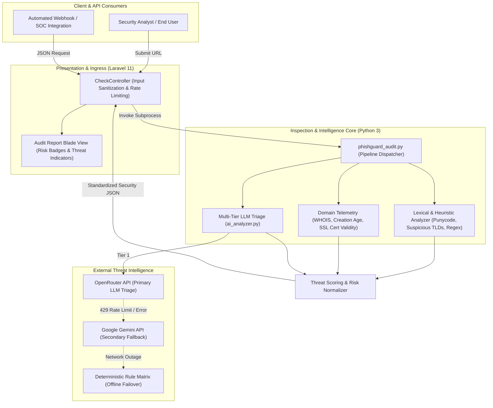

# PhishGuard: Hybrid URL Threat Intelligence & Phishing Inspection Engine

> **AI-powered hybrid URL threat intelligence and anti-phishing inspection platform combining deterministic lexical analysis, domain registration telemetry (WHOIS/SSL), and multi-LLM automated security triage with cascade fallback.**

[](https://github.com/NURJAKS/phishguard-threat-intelligence/actions/workflows/ci.yml)
[](https://www.php.net/)
[](https://laravel.com/)
[](https://www.python.org/)
[](https://ai.google.dev/)
[](https://tailwindcss.com/)
[](LICENSE)

---

## Pitch & Executive Summary

**PhishGuard (Link Scanner)** is an automated application security and threat intelligence engine engineered to detect zero-day phishing campaigns, brand typosquatting, and deceptive URL redirections. Rather than relying solely on static blacklists that rapidly become stale, PhishGuard utilizes a multi-layered defensive pipeline combining deterministic lexical parsing, WHOIS/SSL domain reputation scoring, and an adaptive multi-model LLM classification engine (**OpenRouter / Google Gemini**) with graceful offline fallbacks.

The system exposes both a unified web audit console and a JSON API, producing granular composite threat vectors, risk confidence scores (`0% - 100%`), and actionable containment recommendations.

---

## Architecture Overview

The inspection engine decouples web intake from computationally intensive external security lookups via an orchestrated pipeline:



### Architectural Highlights

- **Multi-Layered Defense-in-Depth:**
  1. **Lexical Inspection:** Identifies homoglyph attacks, punycode spoofing, excessive subdomains, brand impersonation keywords, and high-risk TLDs.
  2. **Infrastructure Telemetry:** Inspects domain registration timestamp, registrar legitimacy, authoritative DNS records, and SSL certificate validity.
  3. **Multi-Model LLM Semantic Reasoning:** Sends sanitized page context to deep learning models to discern deceptive intent, urgency manipulation, and credential harvesting patterns.
- **Cascade Fallback Strategy:** If the primary AI provider encounters rate limits (HTTP 429) or service degradation (HTTP 503), the engine automatically falls back to secondary LLM endpoints before defaulting to strict local heuristic rules, guaranteeing zero-downtime availability.
- **Explainable Threat Indicators:** Instead of a black-box verdict, the engine outputs concrete indicators (e.g., *Domain registered < 7 days ago*, *Punycode detected*, *Fake banking login layout*).

---

## Key Enterprise Features

### 1. Zero-Day Phishing & Typosquatting Detection
- Advanced regex and algorithmic matching detecting brand impersonation (e.g., `paypal-security-update.com`, `apple-login-verify.net`).
- Punycode / IDN homograph decoding preventing ASCII lookalike domain spoofing.

### 2. Multi-Vendor AI Security Triage
- Automated prompt engineering constraining model outputs to structured JSON schema verdicts.
- Resilient retry mechanism handling ephemeral network hiccups with exponential backoff.

### 3. Comprehensive Domain Telemetry
- Automated age calculation: domains registered less than 30 days prior are flagged with elevated risk weighting.
- SSL/TLS certificate chain inspection verifying certificate authority validity and expiration deadlines.

### 4. Interactive SOC & Triage Console
- High-visibility security dashboard displaying instant safety ratings: `SAFE`, `SUSPICIOUS`, or `DANGEROUS`.
- Clear breakdown of detected threat factors, domain metadata cards, and copyable audit reports.

---

## Tech Stack & Architectural Rationale

| Layer | Technology | Architectural Rationale |
| :--- | :--- | :--- |
| **Web Ingress** | **Laravel 11 (PHP 8.2)** | Robust web application framework with built-in CSRF protection, input validation, and flexible routing. |
| **Analysis Pipeline**| **Python 3.10+** | Rich ecosystem for network inspection, WHOIS parsing, socket connections, and text parsing. |
| **AI Inference** | **Google Gemini & OpenRouter** | High-precision natural language comprehension identifying subtle social engineering cues in text. |
| **Styling & UI** | **TailwindCSS & Blade** | Responsive, accessible interface optimized for fast threat assessment on both desktop and mobile devices. |

---

## Repository Structure

```text
├── app/
│   └── Http/Controllers/CheckController.php # Web controller & Python execution bridge
├── python_scripts/
│   ├── phishguard_audit.py                  # Master audit orchestrator
│   ├── ai_analyzer.py                       # Multi-provider LLM classification engine
│   ├── domain_info.py                       # WHOIS, DNS, and SSL certificate analyzer
│   ├── official_sources.json                # Trusted domain whitelist database
│   ├── rules.json                           # Suspicious patterns & high-risk TLD definitions
│   └── requirements.txt                     # Python dependencies (requests, whois, etc.)
├── resources/views/                         # Blade templates (Dashboard, Link Checker)
├── routes/web.php                           # Route registrations
├── .env.example                             # Documented environment variables
└── README.md                                # System architecture and deployment guide
```

---

## Getting Started

### Prerequisites

- **PHP 8.2+** and **Composer**
- **Python 3.10+** with `venv`
- **Node.js** & **npm**

---

### Step 1: Install Dependencies

1. **Clone repository:**
   ```bash
   git clone https://github.com/NURJAKS/Link-Scanner.git
   cd Link-Scanner
   ```

2. **Configure PHP environment:**
   ```bash
   composer install
   cp .env.example .env
   php artisan key:generate
   ```

3. **Configure Python Environment:**
   ```bash
   python3 -m venv venv
   source venv/bin/activate
   pip install -r python_scripts/requirements.txt
   ```

4. **Install Frontend Assets:**
   ```bash
   npm install && npm run build
   ```

---

### Step 2: Configure AI Credentials

Edit `.env` to configure your API keys (at least one is recommended for AI triage):

```env
OPENROUTER_API_KEY=your_openrouter_api_key_here
GEMINI_API_KEY=your_gemini_api_key_here
APP_PORT=8000
```

---

### Step 3: Launch Service

```bash
php artisan serve
```

Open [http://localhost:8000](http://localhost:8000) in your browser.

---

## Verification & CLI Testing

You can test the core inspection engine directly from the command line:

```bash
# Run standalone audit on a test domain:
python3 python_scripts/phishguard_audit.py https://example.com
```

Expected JSON Output:
```json
{
  "status": "success",
  "url": "https://example.com",
  "domain": "example.com",
  "verdict": "SAFE",
  "risk_score": 0,
  "confidence": 98,
  "ai_analysis": {
    "provider": "openrouter",
    "threat_type": "none",
    "explanation": "Legitimate reserved domain with valid historical registration."
  }
}
```

---

## License

This project is licensed under the MIT License.
